<!--
  ARIJIT ROY · PROFILE README · "The Engineer Arc"
  All art in /assets is hand-built animated SVG, so it needs no external services.
  TODO before pushing: swap the portfolio links on EP.01, 02, 04, 05 and 06 for each project's repo or demo URL.
-->

<a href="https://portfolio-arijitroy.vercel.app/">
  
</a>

 


## ⚡ Recruiter Speedrun · 30 seconds

| | |
|:--|:--|
| 🎯 **Looking for** | SWE · Backend · AI-Infra · Developer-Tools **internships** |
| 🧠 **Strongest at** | Multi-agent LLM systems, Python/FastAPI backends, cloud infra (AWS · GCP · Terraform) |
| 🏆 **Proof** | 🥈 2nd at LNMHacks 8.0 (x402 track) · 🦄 Uniswap Hook Incubator 6 graduate · 📈 +30% agent benchmark (Warehouse Env) · 🏭 −20% manual logging at Tata Steel |
| 🎓 **Base** | B.Tech ECE, The LNM Institute of Information Technology, Jaipur |
| 📬 **Fastest reply** | [arijitroy0445@gmail.com](mailto:arijitroy0445@gmail.com) |

  

## 📺 The Series · Featured Episodes

> Six builds, each one a different engineering problem. Click any card to watch.

<table>
<tr>
<td width="50%" align="center">
<a href="https://portfolio-arijitroy.vercel.app/"></a>
 <b>🛡️ Infra regressions + LLM hallucination checks before merge</b> · <a href="https://portfolio-arijitroy.vercel.app/">▶ Watch</a>
</td>
<td width="50%" align="center">
<a href="https://portfolio-arijitroy.vercel.app/"></a>
 <b>🏭 Deterministic, evidence-backed warranty adjudication</b> · <a href="https://portfolio-arijitroy.vercel.app/">▶ Watch</a>
</td>
</tr>
<tr>
<td width="50%" align="center">
<a href="https://github.com/arijitroy667/Warehouse_env"></a>
 <b>🧪 Built for the Meta-PyTorch OpenEnv Hackathon</b> · <a href="https://github.com/arijitroy667/Warehouse_env">📂 Source</a>
</td>
<td width="50%" align="center">
<a href="https://portfolio-arijitroy.vercel.app/"></a>
 <b>🧠 Agents debate and verify before they answer</b> · <a href="https://portfolio-arijitroy.vercel.app/">▶ Watch</a>
</td>
</tr>
<tr>
<td width="50%" align="center">
<a href="https://portfolio-arijitroy.vercel.app/"></a>
 <b>⛓️ Smart-contract defense with agent risk scoring</b> · <a href="https://portfolio-arijitroy.vercel.app/">▶ Watch</a>
</td>
<td width="50%" align="center">
<a href="https://portfolio-arijitroy.vercel.app/"></a>
 <b>📈 AI market intelligence for Polymarket</b> · <a href="https://portfolio-arijitroy.vercel.app/">▶ Watch</a>
</td>
</tr>
</table>

## 🧬 Character Sheet

  

### ⚙️ How I fight bugs · the build loop

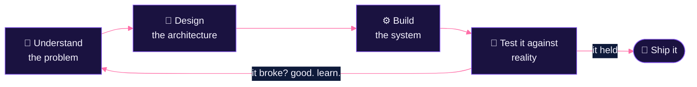

## 🗡️ Arsenal

**Languages** 

**Backend & Data** 

**Frontend** 

**Cloud · DevOps · Infra** 

## 📜 The Story So Far

<table>
<tr>
<td width="62%" valign="top">

### 🏭 Tata Steel Ltd. · Summer Intern
**Industrial Automation & Data Acquisition**

- Built automated **data-acquisition pipelines in Python + SQL** to monitor operational-technology systems.
- Cut manual data-logging time by **20%** across manufacturing workflows.

### 🤝 Cipher, LNMIIT · Organizing & Sponsorship Lead
Running the Web3 and cybersecurity club: events, sponsors, and the people who show up to build.

</td>
<td width="38%" valign="top">

### 🏆 Trophy Room

| | |
|:--:|:--|
| 🥈 | **LNMHacks 8.0**: 2nd place, x402 track (Courtney AI) |
| 🦄 | **Uniswap Hook Incubator 6**: graduate |
| 🧪 | **Meta-PyTorch OpenEnv Hackathon**: Warehouse Env |

</td>
</tr>
</table>

<b>✍️ Side Quest · Technical Writing</b> <i>(click to open)</i>

 

I write about the systems and protocols I'm learning, aiming to make hard engineering ideas easy for other developers to pick up:

- 🔁 **DeFi protocols & automated market makers**
- 📄 **Ethereum Improvement Proposals (EIPs)**
- 🤖 **AI agent architectures & emerging developer tools**

<b>🥚 Hidden Episode</b> <i>(for the curious only)</i>

 

> **You found EP.07.** 🎌
>
> Recruiters and engineers who make it this far get a standing offer: pick **any** project above and I'll walk you through the architecture, the trade-offs, and the parts that broke, in a 30-minute call.
>
> Email me with the subject **`EP.07`** and I'll know you read the whole thing.

## 🐍 Training Arc

<picture>
  <source media="(prefers-color-scheme: dark)" srcset="https://raw.githubusercontent.com/arijitroy667/arijitroy667/output/ninja-snake.svg"/>
  <source media="(prefers-color-scheme: light)" srcset="https://raw.githubusercontent.com/arijitroy667/arijitroy667/output/github-snake.svg"/>
  
</picture>

<b>📊 Power readings</b> <i>(GitHub stats)</i>

 

 

 

<a href="mailto:arijitroy0445@gmail.com">
  
</a>

 

**Interested in:** Backend Engineering · AI Infrastructure · Full-Stack · Developer Tools · Open Source

Art in this README is original, hand-coded animated SVG. No templates were harmed.

